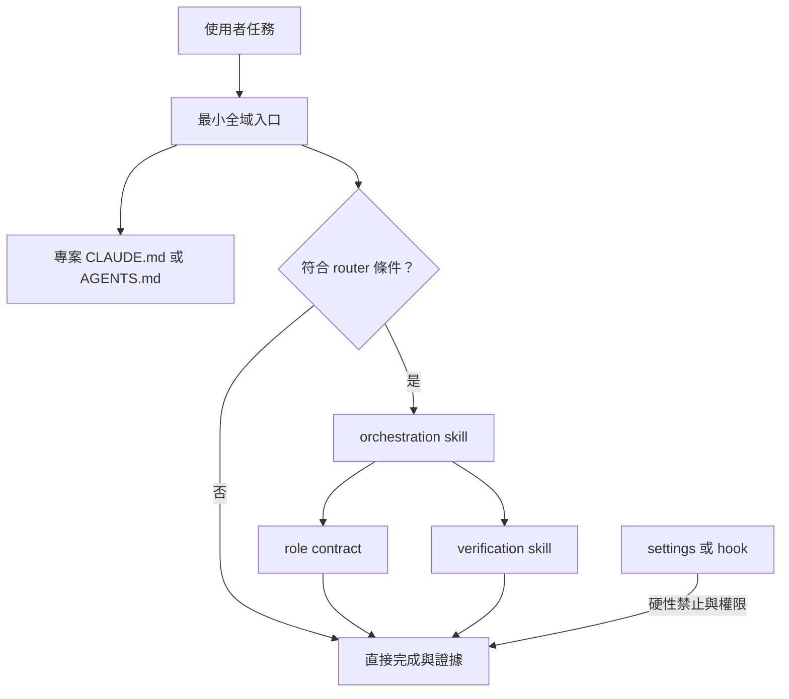

# 全域政策 ownership 與 context 成本審查（2026-10-19）

讀者：維護全域 Claude Code／Codex 工作制度的人。

型別：參考

範圍：全域入口、Claude 常駐規則、controller 注入、Codex 派工文件、agent 合約與 skill 的責任分配。

本文件不修改任何規則、設定、hook、agent 或 skill。

## 結論

全域層應只承擔跨專案、跨 runtime 且需要每回合知道的安全邊界與最短路由。

專案的建置指令、品質門檻、Git 慣例、架構與團隊流程應由專案 own，不能再由個人全域規則重述。

多步驟程序、模型挑選、完整 brief、升降級與模板應改由按需 orchestration skill 載入；agent 定義只保留角色權限與不可跨越的工作樹契約。

這會減少常駐內容，也會讓不需要派工的任務不再先支付 controller 制度成本；它不等於應少派所有 agent。

低風險單檔或可機械驗證的工作可直接完成並附證據；跨模組、未知原因、架構、安全、不可逆效果或獨立驗收需求才進入完整 workflow。

不主張以「模型較強」刪除授權邊界、證據要求、工作樹所有權或高風險獨立驗收。

## 問題與判準

要解的是固定初始 context 與週配額壓力，不是把規則改寫得更短卻仍要求全部讀完。

採納後，一個與制度無關的專案任務不必知道所有模型別名、全部角色模板、所有安裝陷阱與每種驗收輪次。

一個需要制度協助的任務仍要能找到正確 skill、正確 role、正確權限與正確驗收強度。

同一個概念只能有一個 canonical owner；入口只說何時轉交，不複製執行細節。

任何涉及外部寫入、難以回復操作或共享工作樹的行為，不能因瘦身而失去明確邊界。

## 證據與限制

下列靜態數字是 UTF-8 bytes，不是 token，也不是任何模型的實際 input token 計數。

bytes 能指出重複和常駐面積，不能推得節省百分比、週配額或輸出品質。

本輪檢查了 repo 檔案與公開產品文件；沒有重跑私人 transcript 分析，也沒有變更本機設定。

`~/.claude/settings.json` 的 language 值已由主對話以白名單方式確認為「繁體中文台灣用語」；它只支持 Claude 去重候選，對每個 runtime 的行為效果未實測。

Claude 的實際 context、hook 注入時機與 Codex child 的最終 prompt 都應在採納時另作 runtime probe。

| 載入集合 | 靜態 bytes | 解讀 |
|---|---:|---|
| Claude 共用：入口、`rules/`、本機 facts | 22,294 | 無條件規則與 host import 的候選面積 |
| Claude controller 額外內容 | 25,016 | 只要路由到主對話注入就會付出的面積 |
| Claude worker／verifier | 6,775／7,897 | 每個特化 child 的角色合約面積 |
| Codex `AGENTS.md` | 6,495 | 每個 AGENTS 載入路徑的入口面積 |
| Codex dispatch 加模板 | 51,375 | 需要派工時的文件面積，非已量得的 prompt token |

數字來源是本輪 `wc -c`；Claude 分組與 controller 分流的安裝設計見 [docs/install.md](../install.md) 的〈SessionStart hook：注入 controller 專用規則（必裝）〉。

## 產品與外部工作流依據

Anthropic 說明把 CLAUDE.md 視為 context 而非強制設定，並建議把多步驟程序或局部規則移到 skill 或 path-scoped rule。[How Claude remembers your project](https://code.claude.com/docs/en/memory)

同一文件指出 import 只是在啟動時展開內容，並不減少 context 成本；無 `paths` 的 rule 會無條件載入。[How Claude remembers your project](https://code.claude.com/docs/en/memory)

Claude Code 的 skill 依 frontmatter 描述決定何時載入，skill body 應保持簡短，因為載入後跨回合留在 context。[Extend Claude with skills](https://code.claude.com/docs/en/skills)

Claude Code 的成本文件區分 context 成本和 agent-team 成本：每個 teammate 都有自己的 context window，cost 近似隨人數增加。[Manage costs effectively](https://code.claude.com/docs/en/costs)

hook 可以在 lifecycle 的固定事件上執行，適合小型 router 或 deterministic guard，並非把長政策全文塞回 session 的理由。[Hooks reference](https://code.claude.com/docs/en/hooks)

`pstack-claude` 的原始 routing reference 與 hook 都指向同一做法：SessionStart 放短 router，符合條件才 invoke `poteto-mode`，完整 skill 才載入。[Automatic routing](https://github.com/michael-denyer/pstack-claude/blob/main/docs/reference.md#automatic-routing) [session-start-context.md](https://github.com/michael-denyer/pstack-claude/blob/main/plugins/pstack/hooks/session-start-context.md)

其 `poteto-mode` 把工作依難度配模型、要求 consolidated brief，並以不同模型取得第二意見；這些是 workflow 選項，不是所有任務都必須 spawn 的理由。[poteto-mode skill](https://github.com/michael-denyer/pstack-claude/blob/main/plugins/pstack/skills/poteto-mode/SKILL.md)

## 現行責任地圖

| 層 | 現有入口 | 合理責任 | 主要問題 |
|---|---|---|---|
| 全域 Claude | [CLAUDE.md](../../CLAUDE.md) | 最低安全、語言、短路由 | 常駐規則、hook 與派工授權在此匯合 |
| Claude rules | [rules/](../rules/) | 每 session 都需知的事實 | 使用者背景、派工方法、長驗收語義混在無條件區 |
| Claude controller | [rules-controller/](../rules-controller/) | controller 才需的策略 | SessionStart 注入整份派工與判斷細節 |
| Claude agents | [agents/](../agents/) | role 的工具／寫入界線 | 可保留具體角色契約，不能承擔全域工作流 |
| Codex 全域 | [AGENTS.md](../../AGENTS.md) | boot、邊界、短路由 | 情境表把許多按需文件列為多步驟任務的預設成本 |
| Codex dispatch | [codex/rules/](../codex/rules/) | runtime adapter 與派工契約 | dispatch 與 A–L 全模板被一起要求閱讀 |
| skills | [skills/](../skills/) | 有 trigger 的程序與參考 | 已有合適容器，尚未成為 orchestration 的主 owner |
| hooks／設定 | [docs/install.md](../install.md) | deterministic enforcement 與短注入 | 行為指示與強制擋板仍需區分 |

Claude 入口第 16 行明說 `rules/` 常駐而 controller 由 hook 注入；第 23–25 行已把維護與文件程序交給 skills。

Codex 入口第 19–36 行把多種情境指向文件；第 40–42 行則重述跨平台鐵律。

環境規則第 6–27 行同時放使用者背景、派工分流和 context 操作法，是優先搬離常駐區的具體例子。

Codex 的 dispatch 第 55–159 行與模板第 39–215 行含有角色選擇、brief 與驗收細節，適合由 orchestration skill 依 task 類型索取。

## 要保留的最小全域邊界

保留不等於保留原文或原位置；下表定義必須可被所有 runtime 找到的語義。

| ID | 優先級 | 內容 | 新 owner | 理由 | 採納驗證／回退 |
|---|---|---|---|---|---|
| K-01 | P0 | 對外、共享或難以回復動作須有當次授權 | 各 runtime 入口加一行；permission／hook 做硬擋 | context 不能代替授權 | disposable mock、無 remote／真實收件者，只測 deny gate；不通過即回退 |
| K-02 | P0 | 完成宣稱附可重跑證據與適當狀態 | 各 runtime 入口加一行 | 防止把「做過」說成「證實」 | 抽樣任務的輸出與狀態欄 |
| K-03 | P0 | 不覆蓋他人工作；寫入者有明確 scope | agent contract 與 orchestration skill | 這是共享工作樹的結構邊界 | 平行寫入 probe 與 `git diff --check` |
| K-04 | P0 | 高風險變更需要獨立驗收 | verification skill 與 verifier contract | 評估者不能是原製作者 | 驗收 brief、fresh context 與產物 read-back |
| K-05 | P1 | Claude 採已查到的 language setting；Codex 保留一行 fallback | Claude setting；Codex 入口 | 尚未查到 Codex 等價 key，不能把 Claude 設定外推 | Claude 語言 probe；查到 Codex key 前不刪 Codex 文字 |
| K-06 | P1 | 專案規格優先於個人流程 | 兩個入口各一行 | 避免全域指令覆蓋團隊契約 | 專案規格僅處理流程，不可豁免 K-01 至 K-04；做 precedence probe |
| K-07 | P0 | 找到本系統 repo 與本機 facts 的最短 bootstrap 路徑 | 全域入口加一行；`rules/05`／`hosts/` | 新機器與複本安裝不能靠推測路徑 | hostname、symlink／複本與缺 host 三種 probe |

K-01 不可只留在提示文字。Claude 文件也明確把禁止操作的可靠執行點放在 PreToolUse hook 或 settings，而非 CLAUDE.md。[How Claude remembers your project](https://code.claude.com/docs/en/memory)

## 刪除與搬移候選

| ID | 優先級 | 來源 | 處置與新 owner | 理由 | 相依與驗證／回退 |
|---|---|---|---|---|---|
| D-01 | P0 | `CLAUDE.md:6-8`、`AGENTS.md:13-15` | Claude：setting 成功 probe 後刪重複段；Codex：保留一行 fallback | 只有 Claude setting 已查到，不能假設跨 runtime 等價 | Claude probe；Codex 找到並驗證 key 前不動其語言句 |
| D-02 | P0 | `rules/00-environment.md:6-10` | 搬到個人 profile 或 communication skill | 技術背景與 repo 清單不是每個任務所需 | 僅在部署、教學或建議 skill 載入；抽樣確認回應仍符合需要 |
| D-03 | P0 | `rules/00-environment.md:21-27` | 搬到 orchestration skill 的「bulk／context」分支 | 是工作法，不是每回合事實 | 比較單檔任務不再讀此段，複雜任務仍可路由到它 |
| D-04 | P0 | `CLAUDE.md:33` | 取代為 router 對符合條件工作可叫 orchestration skill | 無條件制度性派工把 spawn 變成預設 | 以有／無 router cohort 比較 spawn 數、完成證據與人工介入 |
| D-05 | P1 | `rules/20-judgment.md:9-34` | 保留 K-02 摘要；風險矩陣與停止端搬到 verification skill | 完整判定只在做完或驗收時需要 | 對低風險與高風險各做一個 closed-loop probe |
| D-06 | P1 | `rules/20-judgment.md:14-23` | 搬到 refactor／verification skill | 隱藏檔搜尋、內嵌語言與 mutation 是條件式程序 | 由該 skill 的 trigger 對應實際產物類型 |
| D-07 | P1 | `rules-controller/10-dispatch.md:18-107` | 搬到 orchestration skill；hook 只留 route card | controller 策略不該在不派工時常駐 | router 命中率、錯誤 route 與 context probe |
| D-08 | P1 | `rules-controller/20-judgment-controller.md:5-44` | 搬到 recovery／verification skill | 三輪、升級與問人規則只在失敗或驗收後使用 | 以一個修正輪和一個停止案例走讀 |
| D-09 | P1 | `AGENTS.md:19-36` | 收斂成三個 trigger：project、orchestration、maintenance | 完整情境表會讓簡單多步驟任務先開大量文件 | Codex 直接任務與複雜任務各做 fresh session probe |
| D-10 | P1 | `codex/rules/30-delegation-templates-codex.md:39-215` | 分成 role-specific skill fragments 或由 orchestration skill 產生 brief | A–L 模板不應為一個 role 一次讀完 | named 與 generic fallback 各跑一個 brief completeness check |
| D-11 | P2 | `rules/50-lessons.md` 與 rationale docs | 已被結構、lint、hook 或 skill 承接者移到 archive | 同一教訓不應同時變成常駐文本與程序 | 每條先找承接 owner；零承接不能刪 |
| D-12 | P2 | 安裝文件中的長行為說明 | 留在 `docs/install.md`，不再由入口逐字重述 | 安裝不是一般 coding task 的 context | 新機器安裝 walk-through 與連結檢查 |
| D-13 | P1 | `rules/20-judgment.md:65-69` | 搬到 project Git policy 或 `create-pr` skill | commit、PR、squash 格式是 repo 流程，不是全球語言政策 | project 規格優先；無 project 規格時僅在叫用 `create-pr` 用 skill default，不強制繁中 PR 或英文 commit |
| D-14 | P1 | `rules/20-judgment.md:71-73` | 通用文件方法搬 `writing-principles` 或刪常識；規格、契約與驗收例子的事實保留給 project | 文件方法不應常駐，行為契約仍需 owner | 對規格變更、純重構各做一個文件同步 probe；缺契約事實即回退 |
| D-15 | P0 | `rules/05-hosts.md:1-6`、`hosts/*.md` | 保留最短 bootstrap；版本、port 與工具 gotcha 移 environment diagnostic | 新機器、複本與工具異常需要可發現路徑 | 測三種 bootstrap；需要診斷時才載入 host detail |

刪除候選 D-01 至 D-15 都是設計提案，尚未獲得修改核心判準的授權。

## 專案應 own 的內容

專案 CLAUDE.md 或 AGENTS.md 應只記錄從程式碼不能可靠推得、且該專案每次開工都需要的事實。

例如 build／test 指令、package manager、生成檔規則、資料遷移程序、部署 gate、團隊 Git 規範、架構限制與已知的專案 runtime gotcha。

專案要選定自己的 formatter、lint、測試、review 與 merge 要求；全域層不能替它假定「所有專案都要同一套」。

專案的 path-specific coding 規範應用 `.claude/rules` 的 `paths`，不是把語言框架與每個子系統的規則放進使用者層。

跨專案共用但只在特定意圖出現的操作，例如開 PR、修改制度、文件驗收、平行切分，應由 skill own。

全域層只需告訴 agent：先讀 project instruction；若工作屬於已註冊的 workflow，再呼叫那個 skill。

## 建議的目標形狀

最小 Claude／Codex 入口都應包含 K-01、K-02、K-05、K-06、K-07，並以一段 3 至 5 行的 router 指向按需 skill。

本系統提案的 router 條件宜是：跨檔簽名或資料流改動、架構選擇、未知 root cause、性能問題、安全／不可逆效果、或使用者明確要求平行／獨立驗收。

本系統提案中，單檔格式、明確的局部修正、純查詢、可由一個既有指令驗證的變更不應命中 router。

router 選擇 skill，skill 才決定是否需要 planner、worker、verifier 或第二意見。

agent contract 只接收已裁切的 scope、寫入所有權、驗證命令和停止條件；它不重述全域偏好、安裝文件或別的角色模板。

hook 只適合 inject route card、檢查設定與拒絕可判定的危險操作；較長的解釋留在 skill 或 docs。

## 完整 plan gate 與雙方案規劃

完整 approved plan gate 應保留給跨模組寫入、共享工作樹、架構決定、高風險或已失敗重試。

它不應套用於單檔、低風險、可立即驗證的機械變更，否則 planner 的 context 與手工 brief 成本高於風險降低。

對一般變更，最小 brief 可只有：目標、可寫檔案、不可變條件、驗證命令。

對完整 gate，補上依賴順序、寫入所有權、風險、回退與 completion criteria。

雙方案或多模型 panel 只適用於沒有既有先例的架構抉擇、兩次共用前提失敗、或決策錯誤成本高且能比較獨立方案的情況。

未知 bug 不自動需要雙方案；先以單一 reproduction 和 root-cause 路徑建立證據，只有假設相互競爭時再啟動 panel。

這個門檻借鏡 pstack 的「依 task route workflow」，但不接受「任何非平凡任務都先 fan-out」的解讀。

## pstack 的可借鏡、既有優勢與不可照抄

| 面向 | 可借鏡 | 本系統已有較強處 | 不應照抄 |
|---|---|---|---|
| 入口 | 短 SessionStart router，完整 playbook 按需讀 | 已區分 Claude controller 與 child 的注入面 | 不能把 pstack 的 mandate 原文當全域規則 |
| 技能化 | 用一個 mode 選 playbook，原理可各自引用 | 已有 maintenance、writing、parallel 等具體 skill | 安裝大量 skill 不保證 context 或 spawn 下降 |
| 模型分流 | 依難度與角色配置 effort | Codex 有 runtime adapter、named role 與 fallback 證據 | 外部模型名稱、工具與 permissions 不可直接複製 |
| 委派 | 用 file pointer 和 consolidated scope | 既有工作樹所有權、single-writer 與 verifier 契約更明確 | 不以「保護 context」作為每次 spawn 的充分理由 |
| 安全 | 對 irreversible writes 暫停 | 已明定授權、不可逆與對外操作邊界 | pstack 對部分外部動作的預設自主性不符合本系統 |

`poteto-mode` 的「將教訓編碼為 lint、metadata 或 script」可作為 D-11 的遷移檢查，不是新增更多常駐文字的理由。

## 採納批次

### Batch 0：建立基線，不改政策

記錄兩個 runtime 的 `/context` 或等效 context 檢視、`/usage` 或訂閱用量指標、router 命中、spawn 數、驗收重工與人工介入。

選同類型任務做前後比較；不要把不同專案、不同模型或不同難度混成單一節省數字。

成功條件是資料可判讀，不是立即降低某個百分比。

### Batch 1：最低風險去重

實作 D-01、D-02、D-12 與 D-15，保留單一 canonical owner、bootstrap 與明確 fallback。

驗收包含新 session 的語言、profile 相關建議、安裝連結和 project precedence。

任何 runtime 語言或入口行為退化即還原該 batch。

### Batch 2：短 router 加按需 orchestration skill

建立一個跨 runtime 的 orchestration skill，將 D-03、D-04、D-07、D-08、D-09 的程序移入。

D-13 依候選表由 project Git policy 或 `create-pr` skill 承接，不納入 orchestration。

Claude hook 僅 inject route card；Codex 入口以相同 trigger 指向 skill，無 project instruction 時仍要能使用這個 fallback。

驗收三類 task：直接局部修正、跨模組變更、未知 bug；記錄 route 正確性、spawn 數與完成證據。

### Batch 3：收斂 role 與驗證強度

實作 D-05、D-06、D-10、D-14，將 Codex A–L 模板拆成所需 fragment，將風險矩陣放進 verification／recovery 分支。

保留 K-01 至 K-04，並以低風險機械結案、一般 fresh review、高風險驗收各走一次。

角色檔、runtime adapter 與 hook 的行為屬制度核心，這一批需要使用者另行核定修改範圍。

### Batch 4：日落或回退

若 route 漏接、錯誤授權、驗收品質下降或使用者反覆需要手動補回資訊，就回退該候選而非加更多例外文字。

若基線顯示無明顯成本改善但程序可讀性與 ownership 改善，將決策記為可維護性採納，不假稱配額收益。

## 驗收矩陣

| 需求 | 檢查 | 通過條件 |
|---|---|---|
| 常駐減量 | runtime context 檢視與靜態 bytes | 被搬內容不在無條件集合，且 router 可找到 owner |
| 不少派必要 agent | task log | router 只在條件命中時叫 workflow；必要的獨立驗收仍存在 |
| 不降低安全 | disposable permission／hook 探針 | 不接 remote、不聯絡真實對象，K-01 的 deny gate 不通過 |
| 不降低證據品質 | 完成回報抽樣 | 每個完成項有命令輸出、read-back 或明確待 CI 狀態 |
| 不遺失專案規格 | project instruction probe | 專案 build、test、Git 與架構規範仍優先可見 |
| 可回退 | 小 batch diff 與基線 | 每個候選可獨立還原，不做整檔重寫 |

## 未實測項目

Claude `settings.json` language 是否能在所有主對話與 child 路徑取代 Claude 入口的語言文字；Codex 等價 key 尚未查到。

短 SessionStart router 在 startup、resume、clear、compact 與 subagent 路徑的實際注入形狀。

Codex 對精簡 AGENTS 路由、on-demand skill 與 child contract 的實際 context 差異。

將 Codex 模板拆成 fragment 後，named role、generic fallback 與 direct CLI review 的 brief 完整性。

各 batch 對實際 token、週配額、完成時間、spawn 數與品質的影響。

## 研究 rubric 的開放題

「新模型自然能遵守精簡規則」的證據最薄；產品文件支持避免 over-prompting，卻沒有證明此制度的每個邊界都可移除。

此命題的驗證是採納後對 K-01 至 K-07 的 task suite，並比較漏接率與人工補正；本輪未實測。

「每週用量將下降」同樣沒有本輪證據；靜態 bytes、agent 次數和 token 使用量是不同量。

此命題要以同類任務的 baseline、模型、context、spawn、完成時間與品質結果分開記錄；本輪未實測。

router 是否同時有足夠 recall 與 precision 尚缺 runtime 證據，故 Batch 2 必須保留直接工作與人工指定 skill 的入口。

## 實作前的決策

先核定 K-01 至 K-07 是否是新的最小全域合約，再決定 Batch 1 是否開工。

核心 rules、agent role 職責、permission 與 hook 會改變制度行為；本審查不足以授權直接修改它們。

採納時每一批都應由製作者以機械檢查驗證，並由 fresh-context verifier 做 read-back；這份報告本身不構成 runtime 成功證據。

## repo 定位索引

| 主題 | 定位 |
|---|---|
| Claude 常駐／按需載入 | `CLAUDE.md:14-25` |
| Claude 安全與派工授權 | `CLAUDE.md:27-37` |
| Codex 情境路由與鐵律 | `AGENTS.md:17-51` |
| 使用者背景與 context 方法 | `rules/00-environment.md:6-35` |
| 完成與驗收語義 | `rules/20-judgment.md:7-34` |
| Claude controller 派工與驗收 | `rules-controller/10-dispatch.md:18-107` |
| Claude controller 升降級 | `rules-controller/20-judgment-controller.md:5-44` |
| Codex adapter、派工、驗收 | `codex/rules/10-dispatch-codex.md:7-175` |
| Codex A–L prompt 模板 | `codex/rules/30-delegation-templates-codex.md:6-215` |
| hook 安裝與 controller 分流 | `docs/install.md:54-80` |
| runtime probe 既有記錄 | `docs/harness-facts.md:41-114` |
